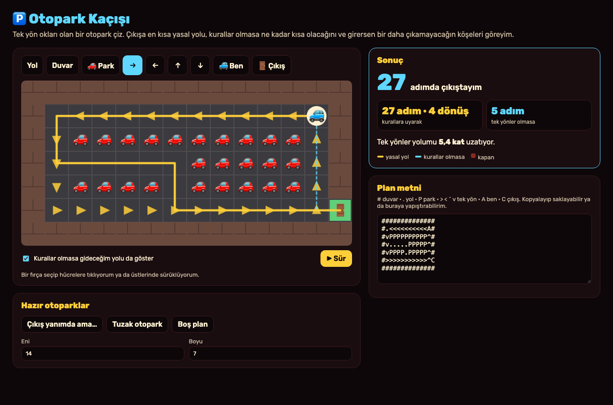
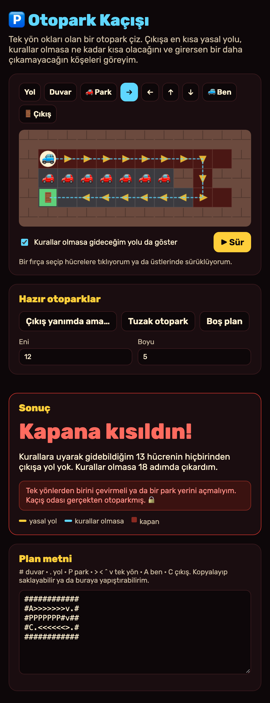

# Otopark Kaçışı

Aklıma bu geldi: Bugün Reddit'te "The real escape room was the parking lot all along" (asıl kaçış odası otoparkmış) diye bir gönderi vardı. Ben de bunu yaşadım: Çıkış hemen yanımda görünüyor ama tek yön okları beni bütün otoparkı dolaştırıyor. Bazen de bir köşeye girince oradan bir daha çıkamıyorum. Ben bu aracı bunun için yaptım. Bir otopark planı çiziyorum, araç bana çıkışa **en kısa yasal yolu**, **kurallar olmasa** ne kadar kısa olacağını ve **girersem bir daha çıkamayacağım köşeleri** gösteriyor. Bu iki resim, benim çalıştırdığım uygulamanın gerçek ekranları.

## Ben nasıl kullanıyorum?

1. Ben bu klasörde `python3 -m http.server 8000` çalıştırıyorum. Sonra `http://localhost:8000` açıyorum.
2. Ben üstteki fırçalardan birini seçiyorum: **Yol**, **Duvar**, **🚗 Park** (park etmiş araba), **→ ← ↑ ↓** (tek yön), **🚙 Ben** (benim arabam), **🚪 Çıkış**.
3. Ben plandaki hücrelere tıklıyorum ya da parmağımı/faremi üstlerinde sürüklüyorum.
4. Ben **sarı çizgide** kurallara uyarak gideceğim en kısa yolu, **mavi kesik çizgide** kurallar olmasa gideceğim yolu görüyorum.
5. **Kırmızı hücreler** kapan: oraya girersem tek yönler yüzünden bir daha çıkışa ulaşamam.
6. Ben **▶ Sür** düğmesine basınca arabam yolu adım adım gidiyor.
7. Ben **Plan metni** kutusundan planı kopyalayıp saklayabiliyorum ya da başka bir planı yapıştırabiliyorum.

Ben "Hazır otoparklar" ile hemen deneyebiliyorum. **Hazır otoparklar uydurma.**

## Ben içeride ne yaptım?

**Plan bir ızgara.** Her hücre bir karakter: `#` duvar, `.` yol, `P` park etmiş araba, `> < ^ v` tek yön, `A` benim arabam, `C` çıkış. Planı metin olarak da bu yüzden saklayabiliyorum.

**Tek yön kuralları.** İki kural koydum:

- Tek yönlü bir hücreden okun **tersine** çıkamam (geri geri gidemem).
- Tek yönlü bir hücreye okun **tersi yönünde** giremem.

Yana dönmek ise serbest; gerçek otoparklarda da tek yönlü bir şeritten sağa ya da sola dönebiliyorum.

**En kısa yol: genişlik öncelikli arama (BFS).** Arabamın olduğu hücreden başlıyorum. Önce 1 adımda gidebileceğim hücreleri, sonra 2 adımda gidebileceklerimi, sonra 3… diye halka halka genişliyorum. Çıkışa ilk vardığımda bu en kısa yol oluyor. Her hücreye nereden geldiğimi not ettiğim için yolu geriye doğru takip edebiliyorum. Aynı aramayı bir de kuralları kapatıp yapıyorum ve iki yolu karşılaştırıyorum.

**Kapanlar: ters yönde arama.** Kapanları bulmak için çıkıştan **geriye doğru** arıyorum: "Hangi hücrelerden kurallara uyarak çıkışa gelinebilir?" Arabamın gidebildiği ama bu listede olmayan hücreler kapan.

Ben `core.mjs` içinde hesapları, `app.mjs` içinde çizimi ve fırçayı tuttum. Hiçbir sunucu, hesap ya da API anahtarı kullanmıyorum. Son planım sadece bu tarayıcıda duruyor.

## Ben neyi sınadım?

Ben `node test.mjs` komutunu çalıştırdım. **42 kontrol** geçti.

- Tek yön kuralları: oka doğru girmek serbest, oka ters girmek ve oktan geri çıkmak yasak, yana dönmek serbest çıktı.
- **"Çıkış yanımda ama…"** örneğinde çıkış arabamın 5 adım altında. Ama tek yönler beni bütün otoparkı dolaştırıyor: kurallara uyarak **27 adım ve 4 dönüş**. Yani tek yönler yolu **5,4 kat** uzatıyor. Yoldaki her adımın komşu ve yasal olduğunu da kontrol ettim.
- **"Tuzak otopark"** örneğinde araba kurallara uyarak 13 hücreye gidebiliyor ama hiçbirinden çıkışa yol yok. Kurallar olmasa 18 adımda çıkıyor.
- BFS'yi, bütün yolları tek tek deneyen yavaş bir **kaba kuvvet** yöntemiyle karşılaştırdım. Rastgele üretilmiş **150 küçük otoparkta** ikisi de aynı en kısa yolu buldu. Çıkışın kapalı olduğu yerlerde ikisi de "yol yok" dedi.
- Kapan bulan fonksiyonun bulduğu her hücreye arabayı koyunca gerçekten çıkışa ulaşılamadığını kontrol ettim.

Denerken önemli bir hata yakaladım. Kapanları bulmak için ilk önce en kısa yol aramasının gezdiği hücreleri kullanıyordum. Ama o arama **çıkışı bulunca duruyor**, o yüzden henüz gezmediği kapanları görmüyordu. Test otoparkımda 4 kapan hücresinden birini (sağ alt köşedekini) kaçırıyordu. Şimdi arabanın gidebileceği bütün hücreleri ayrı bir aramayla buluyorum. Bunun için de test yazdım.

Ben uygulamayı tarayıcıda da açtım. Fırçayla tıklama ve sürükleme, sağdaki tek yön sütununu yola çevirince yolun 27'den 5 adıma inmesi, plan metnini yapıştırma, bozuk metin uyarısı, boyut değiştirme ve ▶ Sür çalıştı. Telefon boyutunda (375 piksel) sayfa yana taşmadı.

Benim sınırlarım var. Araba bir hücrelik bir nokta gibi; gerçek bir arabanın dönüş yarıçapı, geri vitesi ve genişliği yok. Rampalar ve katlar yok, otopark tek kat. Diğer arabalar hareket etmiyor.

## Ben bunları nereden öğrendim?

- Genişlik öncelikli arama (BFS): algoritma ders kitaplarında anlatılan, ağırlıksız bir grafikte en kısa yolu bulan temel yöntem.
- Yönlü grafik ve ters yönde arama: aynı kaynaklardaki "bir noktaya kimler ulaşabilir?" sorusunun standart çözümü.

## Ben bugünün kaynaklarına nasıl baktım?

Ben 9 Kasım 2026 saat 01.24 Türkiye vaktinde [GitHub Trending günlük listesine](https://github.com/trending?since=daily) baktım. Gördüğüm 9 repo arasında ilk sırada [sherlock-project/sherlock](https://github.com/sherlock-project/sherlock) vardı ve "bugün 2.372 yıldız" yazıyordu. Gece yarısını yeni geçtiği için liste bir önceki günle aynıydı. Bu, bütün GitHub'ın kesin birincisi olduğu anlamına gelmez. Ben onların kodunu kopyalamadım.

Ben aynı anda [Trends24 dünya listesinde](https://trends24.in/) `Cowboys` adını ilk sırada gördüm. Projeme zorla eklemedim. Bu liste üçüncü taraf bir anlık görünümdür; bütün günün kesin en çok konuşulan konusu demem.

Ben [Reddit r/popular Top/Today listesinde](https://www.reddit.com/r/popular/top/?t=day) ilk sırada r/mildlyinfuriating'de ["More ice than drink"](https://www.reddit.com/r/mildlyinfuriating/comments/1xqngo5/more_ice_than_drink/) gönderisini gördüm; ondan dün ayrı bir proje yapmıştım. Aynı listede r/SipsTea'de ["The real escape room was the parking lot all along"](https://www.reddit.com/r/SipsTea/comments/1xqvbj9/the_real_escape_room_was_the_parking_lot_all_along/) gönderisi vardı. Benim fikrim buradan çıktı. Gönderideki otoparkı bilmiyorum; hazır otoparkları ben uydurdum. Bu tek görünüm, bütün Reddit'in en çok konuşulan konusunu kanıtlamaz.

Ben bu projeyi MIT lisansı ile paylaşıyorum.
